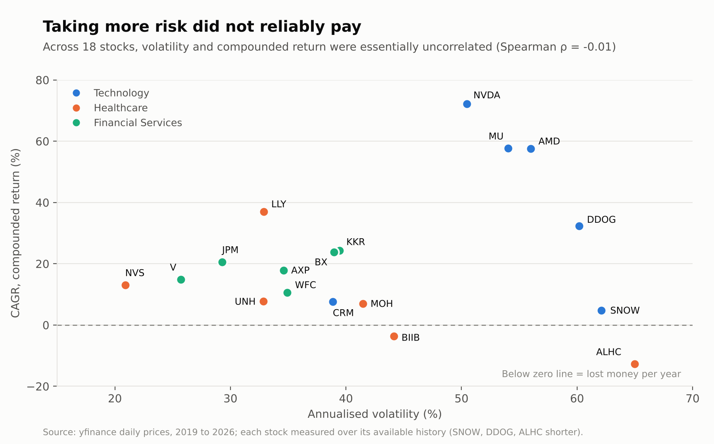
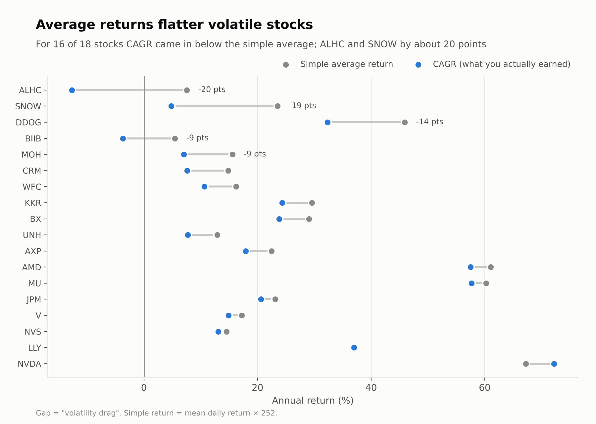
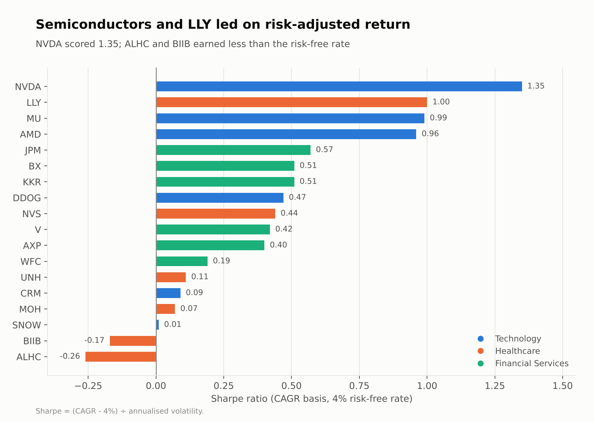
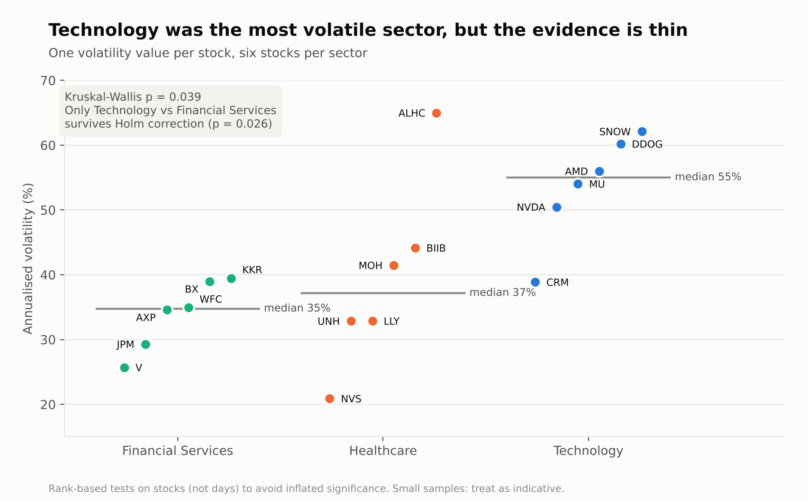

# Does Taking More Risk Pay? A Risk and Return Analysis of 18 US Stocks

Writen by - **Shivam Bhatia**

· [Live dashboard](https://market-analytic.streamlit.app/)
· [Code and notebooks](README.md)

## TL;DR

I analysed 18 US stocks across Technology, Healthcare and Financial Services from 2019 to 2026 to test a common assumption: that taking more risk gets you paid more. In this basket it did not. Volatility and compounded return were essentially unrelated (Spearman ρ = -0.01), average returns overstated what investors actually earned for 16 of the 18 stocks, and sector volatility differed only weakly (Kruskal-Wallis p = 0.039; one sector pair survives correction).

## The question

Investors often treat sector as a shortcut for risk: Technology is "risky", Financials are "steady". I wanted to check whether that holds in the data:

1. Do sectors differ meaningfully in volatility?
2. Does taking more volatility lead to better compounded returns?

## Data and method (short version)

- **Data:** daily prices from January 2019 for 18 hand-picked US stocks, six per sector, from `yfinance` (adjusted for splits and dividends). SNOW, DDOG and ALHC listed later and have shorter histories.
- **Pipeline:** a Python script downloads the prices, a SQLite database stores them (`symbols` and `prices` tables), and SQL window functions (`LAG`, rolling averages, `RANK`) produce returns and rankings.
- **Metrics:** CAGR, annualised volatility, Sharpe ratio and maximum drawdown, using 252 trading days and a flat 4% risk-free rate.
- **Statistics:** rank-based tests (Kruskal-Wallis, then pairwise Mann-Whitney with Holm correction), run on one value per stock, not on daily observations. Treating every day as an independent data point would make almost any difference look significant.
- **Delivery:** an interactive Streamlit dashboard with sector, stock and date filters.

## Findings

### 1. More risk did not reliably mean more return

The three highest compounded returns were semiconductors (NVDA 72%, MU 58%, AMD 58% a year), but the two most volatile stocks, ALHC and SNOW, compounded at -13% and +5%. Across all 18 stocks, volatility and CAGR were uncorrelated (ρ = -0.01, p = 0.96). Volatility describes how bumpy the ride was, not whether it paid.

### 2. Average returns flatter volatile stocks

A stock that rises 50% and then falls 50% has an average return of 0% but leaves you 25% down. That "volatility drag" showed up clearly: for 16 of 18 stocks, compounded growth (CAGR) was below the simple average return, by about 20 points for ALHC and SNOW. The only exceptions were NVDA and LLY.

### 3. Risk-adjusted, a handful of stocks stood out

Using the Sharpe ratio on a compounded basis, NVDA led at 1.35, followed by LLY (1.00), MU (0.99) and AMD (0.96). ALHC (-0.26) and BIIB (-0.17) earned less than the 4% risk-free rate for the risk taken.

### 4. Technology was the most volatile sector, but the evidence is thin

Median annualised volatility was 55% for Technology, 37% for Healthcare and 35% for Financial Services. The Kruskal-Wallis test across the three sectors gave p = 0.039. After Holm correction for three pairwise comparisons, only Technology vs Financial Services stayed significant (adjusted p = 0.026). With six stocks per sector, this is indicative, not conclusive.

### 5. Diversification depends on the sub-sector

The three semiconductor stocks (NVDA, AMD, MU) have pairwise correlations of roughly 0.57 to 0.67, so holding all three behaves more like one large bet than three. The correlation analysis is in [notebook 03](notebooks/03_eda.ipynb).

## What this means

For anyone judging a stock or portfolio from data:

- **Judge on compounded and risk-adjusted measures**, not on average return or sector reputation. The simple average can hide a lot of damage.
- **Check the drawdown, not only the return.** Even the best performer, NVDA, fell 66% from its peak at one point, and every stock in the basket had a fall of at least 26%.
- **Do not assume sector equals risk.** Differences between sectors were modest here, and differences within a sector (for example ALHC vs UNH inside Healthcare plans) were large.
- **Diversify across sub-sectors**, because stocks in the same industry tend to move together.

This is an analysis of history, not investment advice.

## Limitations

- **Small samples.** Six stocks per sector means low statistical power. "Not significant" means this basket cannot tell the sectors apart, not that they are the same.
- **Hand-picked basket.** All large, well-known US companies, so the results describe this basket and carry selection bias.
- **Unequal histories.** SNOW, DDOG and ALHC are measured over shorter windows, so their metrics are not strictly comparable.
- **Simplified assumptions.** A flat 4% risk-free rate and 252 trading days a year.
- **Unchecked outliers.** The outlier analysis flags large negative moves in UNH and MOH in 2025 that I have not yet verified against news.

## What I would do next

1. Replace the hand-picked basket with a random sample of stocks from each sector.
2. Add UK-listed stocks and a market index as a benchmark.
3. Calculate metrics over rolling windows to see whether the sector differences are stable.
4. Verify the flagged outliers against company news.
5. Load the same data into kdb+ and compare the queries with the SQL versions.

## Explore it

- **[Live dashboard](https://market-analytic.streamlit.app/)**: filter by sector, stock and date range, and rank stocks by any metric.
- **[Code, notebooks and README](README.md)**: the SQL pipeline, EDA, risk metrics and statistical tests.
